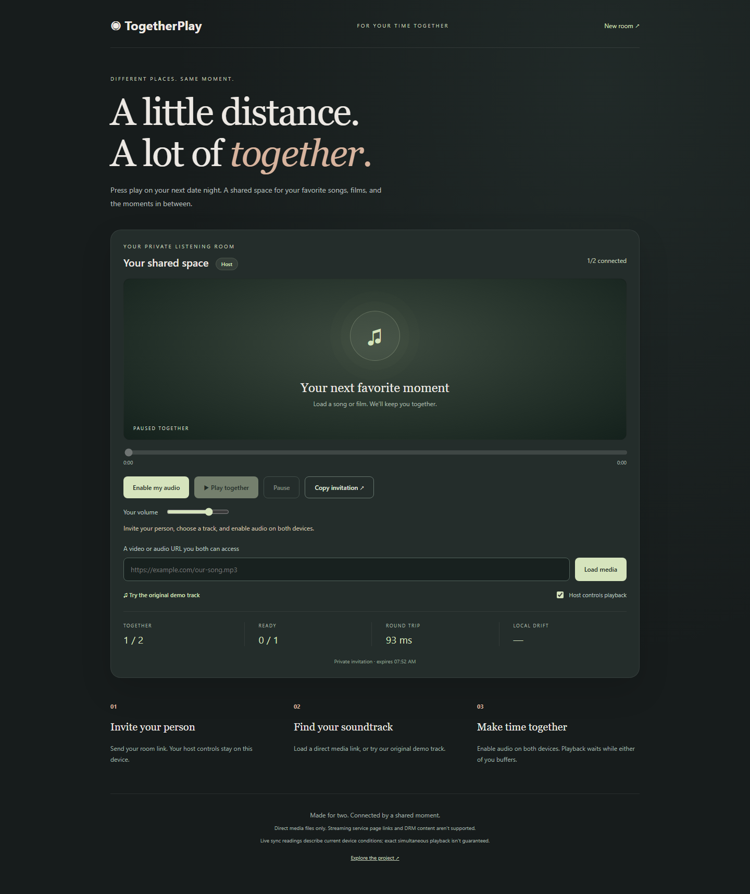
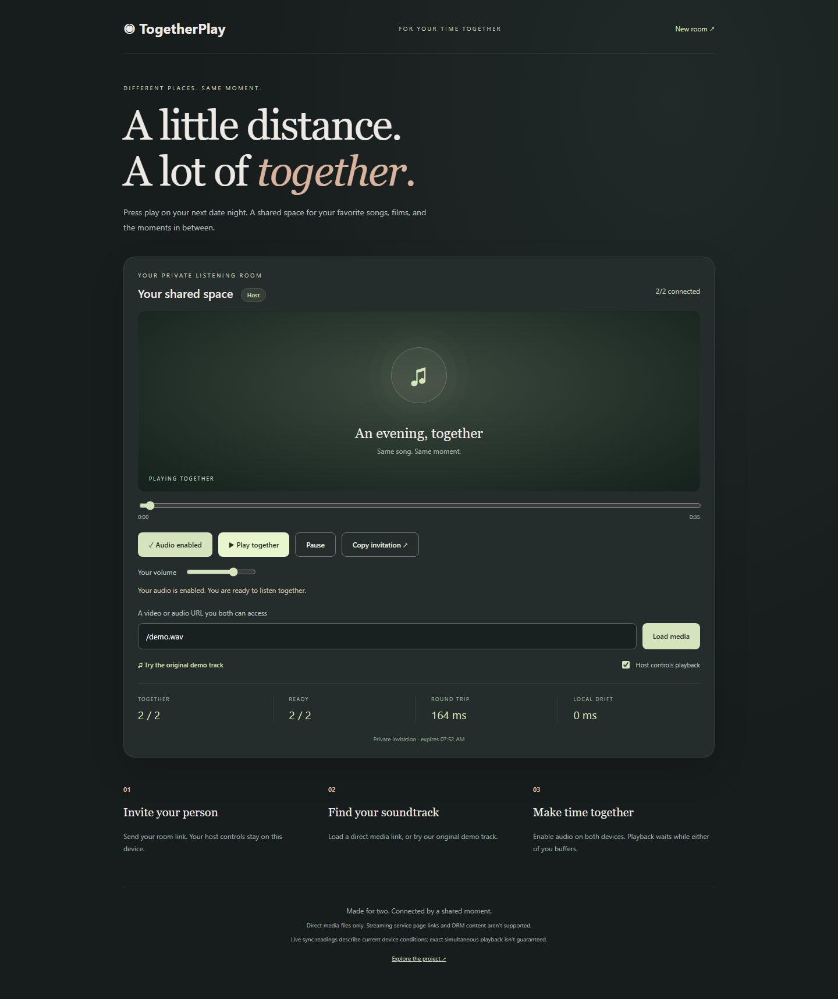
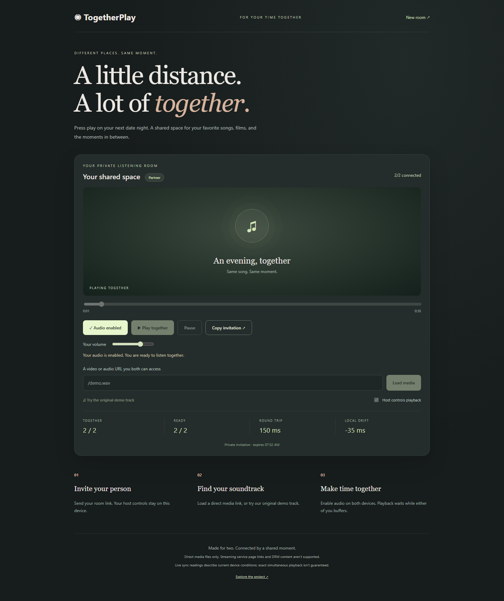
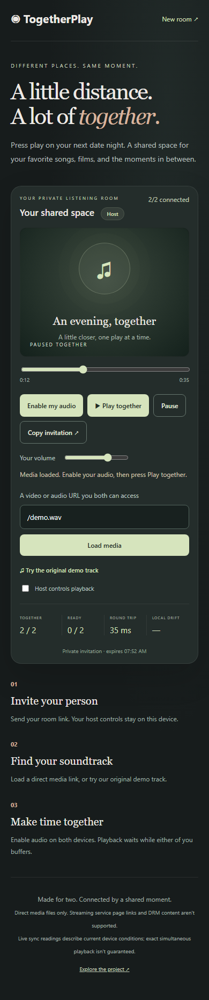
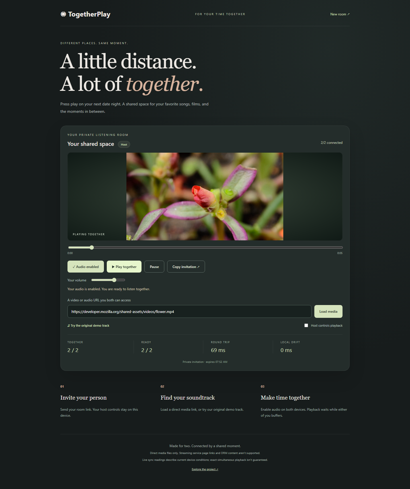
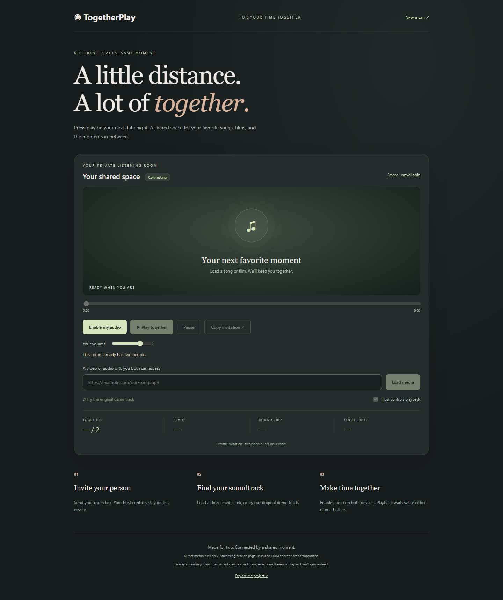
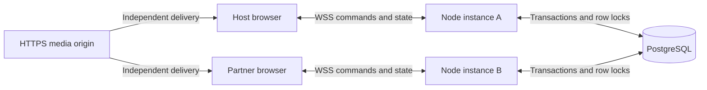

# Networking - TogetherPlay

**Different places. Same moment.** A synchronized video and audio room for long-distance couples, with durable room recovery, coordinated buffering, and live synchronization telemetry.

**[Open the live demo](https://togetherplay-nine.vercel.app)** · [Source code](https://github.com/vams2krish/networking-togetherplay)

**Project type:** Computer Networking / Distributed Systems / Full-stack Web Application. This project does **not** use ML, deep learning, or generative AI. Coordination is deterministic; no model, training dataset, inference service, or AI API is required.

## Product showcase

Real browser captures of the running product, generated during end-to-end verification. Telemetry readings are individual observations, not synchronization benchmarks. Test room invitations expire after six hours.

**Production verified October 29, 2026:** the gallery below was refreshed from the public production URL using isolated Chromium sessions. [Inspect the timestamped test evidence](docs/production-verification.json).

### A shared space, made for two



### Both people ready before the moment starts

Playback waits until every connected participant enables audio and loads enough media. A buffering participant pauses the shared timeline; readiness resumes it.


### Listening together, with live network readings



### Your partner's view

Host-only controls are enforced by the server. Partners can enable audio and set local volume; the host may enable shared playback controls.



### A room that fits your phone



### Video playback



The video showcase uses the flower sample referenced in [MDN's video documentation](https://developer.mozilla.org/en-US/docs/Web/HTML/Reference/Elements/video). It loads directly from MDN; TogetherPlay does not redistribute that video. The built-in audio track is an original synthesized melody with no third-party samples, reproducible with `npm run demo:generate`.

### A space reserved for two

A third independent browser receives an explicit capacity message and cannot enter the room.



## Latest production verification

The October 29 run targeted **https://togetherplay-nine.vercel.app**, with the health endpoint confirming PostgreSQL storage. It completed all eleven recorded checks with no uncaught browser JavaScript errors.

| Flow                         | Verified result                                                                                          |
| ---------------------------- | -------------------------------------------------------------------------------------------------------- |
| Room creation and invitation | Creator is host; a separate browser joins as partner.                                                    |
| Readiness barrier            | Host media stays paused until the partner enables audio.                                                 |
| Actual playback              | Audio advances in both browser sessions; external HTTPS video decodes and advances.                      |
| Shared transport             | Seeking propagates; pause stops the partner's media element.                                             |
| Permissions                  | Partner playback controls are disabled until the host unlocks them; the partner can then start playback. |
| Recovery                     | Both browsers reload into their existing roles with the same media and room membership.                  |
| Mobile                       | The 390px layout has no horizontal overflow.                                                             |
| Capacity                     | A third independent browser is denied entry.                                                             |

The [machine-readable evidence](docs/production-verification.json) records the UTC timestamp, target, storage mode, checked behaviors, and one observed playback difference. Both browsers ran on the same test machine over the public HTTPS/WSS service. This verifies the live product flow; it does not establish long-distance timing percentiles, real-phone compatibility, unclean-network recovery, or sustained production load capacity.

## Try it

1. Open **[TogetherPlay](https://togetherplay-nine.vercel.app)** to create a room.
2. Click **Copy invitation** and send it to your partner. Use a separate browser or device for their view.
3. Click **Try the original demo track**, or load an accessible direct HTTPS media URL.
4. Both people click **Enable my audio** to satisfy browser playback permission requirements.
5. The host clicks **Play together**. Pause and seek affect the shared timeline.
6. Uncheck **Host controls playback** to let either participant control playback.

No signup is required. Invitations grant guest access to an available seat; keep them private. The host credential stays in that tab's session storage and is excluded from invitations. Reloading preserves it. Clearing session storage or changing browsers loses host privileges; create a new room in that case.

## Roadmap delivered in v2

| Step                  | Implemented behavior                                                                                                                                                                     |
| --------------------- | ---------------------------------------------------------------------------------------------------------------------------------------------------------------------------------------- |
| Coordinated buffering | The server pauses while any active member is unready, then resumes requested playback when all are ready. New media invalidates old readiness messages.                                  |
| Sync telemetry        | Round-trip latency, local drift before correction, connection count, and readiness count. Rounded participant measurements live in transient room state.                                 |
| Host permissions      | Host-only playback by default. Only the host may change this setting.                                                                                                                    |
| Expiry                | Fixed six-hour lifetime; expired rooms cannot be revived. Expired records are cleaned when a new room is created.                                                                        |
| Abuse controls        | Two seats; ten creations per IP-derived identity per hour; 1,000 active rooms; per-instance connection caps; message rate limits; 4 KiB payloads; join timeout and bounded backpressure. |
| Durable state         | PostgreSQL row locks serialize mutations. Shared database state and one-second reconciliation coordinate separate server instances.                                                      |
| Recovery              | Exponential reconnect backoff with jitter, authoritative state reload, readiness re-establishment, and local pause on connection closure.                                                |
| Live deployment       | HTTPS/WSS on Vercel, verified database TLS, health endpoint, CI, multi-instance database tests, two-browser audio/video verification, and mobile screenshots.                            |

## Local setup

Requires Node.js 22 or newer. CI and deployment use Node.js 24.

```sh
npm ci
npm start
```

Open `http://localhost:3000`. Development uses process memory when `DATABASE_URL` is absent. Production and Vercel require a database and fail at startup without one.

For persistent local rooms, configure a gitignored `.env.local` from `.env.example`, then run:

```sh
node --env-file=.env.local server.js
```

For LAN use, both devices open `http://YOUR_LAN_IP:3000` with the same invitation. Clipboard access may require HTTPS; a copy failure displays the invitation as text. A localhost invitation only works on the same computer.

## Architecture and networking



- **WebSockets over TCP:** reliable, ordered messages within each connection. Separate connections can reach different instances.
- **Authoritative state:** room mutations use short database transactions with `SELECT ... FOR UPDATE`. Cross-instance reconciliation runs once per second for active rooms. This uses database polling, not pub/sub.
- **Clock estimation:** application ping/pong messages estimate server time using the round-trip midpoint. The lowest-RTT sample among the latest ten determines the offset. This is NTP-inspired, not NTP.
- **Drift correction:** every three seconds, clients compare media position to the authoritative timeline and seek if drift exceeds 350 ms. This threshold is a configuration value, not a measured timing guarantee.
- **Readiness barrier:** playback requires a source, a requested play state, at least one active member, and readiness from every active member. Solo preview works; joining a second person introduces their readiness requirement.
- **Presence leases:** transport pings run every 15 seconds; leases expire after 45 seconds. Clean disconnects pause immediately. Unclean failures can take longer to detect.
- **HTTP range requests:** the built-in audio supports byte ranges for seeking.

```text
estimatedServerNow = clientNow + estimatedClockOffset
playingTarget = savedPosition + max(0, estimatedServerNow - updatedAt) / 1000
pausedTarget = savedPosition
```

Cross-instance propagation, buffering, asymmetric network latency, and device decoding introduce delay. This does not provide sample-accurate audio synchronization. There is no WebRTC, STUN, TURN, or media relay.

## Protocol and security

Clients send `create` or `join` with a random 256-bit session capability. The server stores its SHA-256 hash. Creating a room returns a random 128-bit room identifier; joining a missing room never creates one. The creator's hashed capability grants host privileges. Connection identifiers prevent a replaced socket from removing its replacement session.

Other messages are `ping`, `source`, `control`, `settings`, `ready`, and `telemetry`; responses are `joined`, `state`, `pong`, and `error`. Playback and readiness commands include a source revision. Snapshots exclude credential hashes, connection identifiers, and raw IPs.

```json
{ "type": "control", "playing": true, "position": 12.5, "sourceRevision": 1 }
```

Data lives in an isolated `togetherplay` schema in the existing DuetSync Supabase project. It is not exposed through Supabase's Data API. RLS policies restrict application access to a dedicated `togetherplay_backend` database role with grants on only the two application tables. The application does not use a database administrator or Supabase service-role key. Queries are parameterized, pools are bounded, and database TLS verifies the CA and hostname using the public Supabase certificate in `certs/`.

HTTP responses include CSP, no-referrer, nosniff, anti-framing, and restrictive camera/microphone/geolocation policies. Selected media must use HTTPS, except the fixed built-in `/demo.wav` asset. Credential-bearing URL userinfo is rejected. Browser WebSocket origins must match the current host, or optional exact `APP_ORIGIN`. Native clients may omit Origin but still require valid room/session capabilities.

## Deployment and operations

The demo uses Vercel Fluid Compute and an exported Node.js HTTP server with `ws`; see [Vercel's WebSocket documentation](https://vercel.com/docs/functions/websockets). Durable external state is necessary because separate connections and reconnects may reach different instances.

1. Provision a dedicated database login named `togetherplay_backend` with a securely generated password, no superuser/database-creation/role-creation privileges, a short statement timeout, and database `CONNECT` permission.
2. Apply `db/schema.sql` as an administrator once. It creates only TogetherPlay's schema, tables, indexes, policies, and restricted grants. Never put passwords in this script.
3. Set server-only **Secret** environment variables `DATABASE_URL` and `RATE_LIMIT_SALT` in Vercel. Copy the transaction pooler host from the database's Connect dialog and use the custom database role's username. Never expose these variables to browser code.
4. Link the intended Vercel project and verify the owner and project before deploying.
5. Stage with `vercel deploy --prod --skip-domain`, test the returned URL, then `vercel promote <tested-url>`.
6. Check `GET /healthz` returns `{"status":"ok","storage":"postgres"}` and run the browser suite against the public address.

`APP_ORIGIN` optionally pins one accepted browser origin. `RATE_LIMIT_SALT` hashes the IP-derived creation quota identity. The application avoids logging tokens, media URLs, raw IP addresses, and connection strings. Vercel function duration is 300 seconds: clients reconnect on function rotation and reload persistent state. The function runs in `sfo1`, near the database. Self-managed hosts can run `npm start` behind HTTPS with WebSocket upgrades enabled.

**Operational boundaries:** this is a deployed, tested demo with production safeguards, not an audited or load-certified commercial service. External uptime alerting, log drains, large-scale load testing, an incident response process, and broad browser/device certification are not configured. The health endpoint is available for monitoring. Cleanup is admission-driven, so expired data may remain until the next room creation. Configure backups and retention requirements before collecting sensitive data.

## Verification

```sh
npm test
# Include the database integration test:
node --env-file=.env.local --test test/server.test.js
# Against a running local server:
npx playwright install chromium
npm run test:e2e
```

Set `BASE_URL` to test a deployment. Optional `LIVE_VIDEO_URL` enables the additional video test/showcase. The standard browser suite uses only the original local audio and needs no external media origin. Browser tests intentionally regenerate screenshots in `docs/showcase/`.

Set `PRODUCTION_VERIFY=1` when running against production to require PostgreSQL health and update `docs/production-verification.json`. Ordinary local/CI runs do not replace the recorded production evidence. The suite uses separate host, partner, and capacity-check browser contexts and includes a reload of both participating sessions.

Coverage includes timeline math, URL validation, readiness pause/resume, permissions, stale revisions, capacity, expired sessions, foreign Origin rejection, separate-server state propagation, host recovery, actual media advancement, seeking, and mobile overflow. CI installs from the lockfile, audits production dependencies, runs backend tests, and runs Chromium end-to-end tests.

## Source layout

```text
api/ws.js              Vercel entrypoint
server.js              Standalone Node entrypoint
web-server.js          HTTP, upgrades, queues, leases, reconciliation
room.js                Room state machine and public snapshot projection
store.js               Development memory and transactional PostgreSQL stores
sync.js                Timeline calculations and URL validation
public/                Player interface and original demo audio
certs/                 Public Supabase database CA certificate
scripts/               Demo synthesis and CI server readiness checks
db/schema.sql          Isolated schema, indexes, RLS, restricted grants
test/                  Unit, protocol, origin, database integration tests
e2e/                   Browser flow and screenshot generation
docs/showcase/         Real product screenshots
```

## Remaining roadmap

- Distributed pub/sub to replace one-second reconciliation and reduce database writes and propagation delay.
- Scheduled expiry cleanup and quota retention.
- Room passwords, invitation revocation, optional accounts, and host transfer.
- Captions/subtitles, playback speed, accessible fullscreen, and playlists.
- External uptime/error alerts, load testing, synchronization percentile measurements, and Safari/Firefox/mobile-device coverage.

Netflix, Spotify, YouTube page links, DRM content, uploads, calls, and chat are not integrated. Use direct media you have permission to access. The room server and both participants can see selected URLs; avoid URLs containing private credentials. Invitations can be forwarded and grant a free guest seat. Host capabilities are tab-scoped rather than account-backed. Both browsers depend on the media origin remaining accessible.
