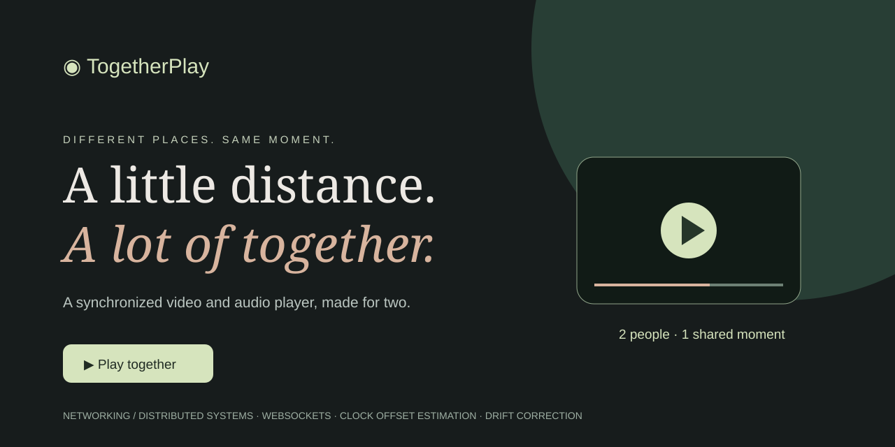
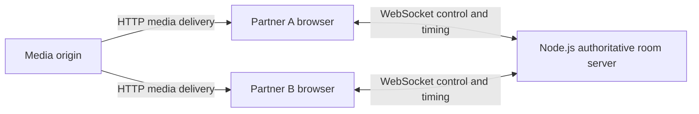

# Networking - TogetherPlay



**A synchronized video and audio player for long-distance couples.** TogetherPlay creates a shared room where two people can watch or listen to the same media, with synchronized play, pause, and seeking. Each device loads the media independently while a Node.js server coordinates playback over WebSockets.

**Project type: Computer Networking / Distributed Systems / Full-stack Web Application.** This is **not an ML, deep learning (DL), or generative AI project**. Synchronization uses deterministic timing and networking logic; there is no model, training dataset, inference service, or AI API dependency.

The image above is a project illustration, not a screenshot or a claim of deployment.

## Features

- Two-person rooms with randomly generated 128-bit invitation identifiers.
- Shared media selection and play/pause/seek controls available to either partner.
- Server-authoritative playback snapshots with revision numbers.
- Clock-offset estimation from application-level ping/pong round trips.
- Periodic playback correction when drift exceeds 350 milliseconds.
- Automatic WebSocket reconnection and state recovery while the other participant remains connected.
- Responsive interface, keyboard-accessible controls, and live connection messages.
- Direct video and audio URLs supported by the browser's native media element.

## Run locally

Install Node.js 22 or newer, then run:

```sh
npm ci
npm start
```

Open `http://localhost:3000`, copy the invitation, and open it in a second tab or browser. Load a direct MP4, WebM, MP3, or another supported media URL, then press **Play together**. The URL must return a media file, rather than an HTML page. Both users must be able to access it.

For two devices on your local network, open `http://YOUR_LAN_IP:3000` on both devices and use the same invitation fragment. Clipboard access may require HTTPS; the app displays the invitation if copying fails. For long-distance use, host the server at a shared HTTPS address with WebSocket support. A localhost invitation only works on the same computer.

Set the `PORT` environment variable if your host requires a different port. No credentials or environment file are needed for local development.

## Networking concepts and architecture



| Concept | Implementation |
| --- | --- |
| Client-server communication | WebSockets carry playback commands and state snapshots. |
| Reliable ordered transport | WebSockets run over TCP; commands from one connection arrive in order. |
| Authoritative state | The server serializes arriving commands and broadcasts the latest room snapshot. |
| Clock synchronization | The client estimates server offset from a ping/pong midpoint and selects the lowest-RTT sample from its last ten samples. This is NTP-inspired, not a full NTP implementation. |
| Latency compensation | A playing target advances by elapsed estimated server time since the snapshot. |
| Drift correction | Clients check every three seconds and seek when their position differs by more than 0.35 seconds. |
| Session isolation | Each invitation maps to an in-memory room, limited to two active connections. |
| Recovery | Clients reconnect after 1.5 seconds and request current room state by joining again. |

For a snapshot with position `p` and update time `t`, the playing target is:

```text
estimatedServerNow = clientNow + estimatedClockOffset
targetPosition = p + max(0, estimatedServerNow - t) / 1000
```

Paused snapshots retain `p`. Clients load the same URL and reconcile toward this timeline. There is no media relay, peer-to-peer streaming, WebRTC, STUN, or TURN in this implementation. TCP reliability does not guarantee simultaneous playback: decoding, buffering, browser policies, and asymmetric network delay still affect timing. The 350 ms correction threshold is a configured tolerance, not a measured synchronization guarantee.

## Protocol

Messages are JSON. Clients send `join`, `ping`, `source`, `control`, or `refresh`; the server returns `state`, `pong`, or `error`.

```json
{"type":"control","playing":true,"position":42.5}
```

A state contains `source`, `playing`, `position`, `updatedAt`, `revision`, and `members`. The last valid command received by the server wins. A late joiner receives the current snapshot. The room is deleted when its final connection leaves; state does not survive a server restart.

## Source layout

```text
server.js              HTTP and WebSocket room server
sync.js                Timing helper and source validation
public/index.html      Player interface
public/app.js          Client connection, clock estimation, synchronization
public/style.css       Responsive styling
docs/togetherplay.svg  Original project cover illustration
test/                  Unit and two-client integration tests
```

## Verification

```sh
npm test
```

Tests cover timeline calculations, URL validation, HTTP delivery, two-client state propagation, room capacity, and separation between rooms. Manual browser verification should include loading a real media file, enabling playback on both browsers, pausing, seeking, joining late, and reconnecting. Automated protocol tests do not prove browser playback quality or internet synchronization accuracy.

## Deployment and limitations

This is a runnable prototype, not a production-hardened service. Use HTTPS/WSS behind a reverse proxy, forward WebSocket upgrades, and run one server instance: rooms live in process memory. Multiple instances require shared state and a pub/sub layer, with explicit command ordering. Host on a service supporting a continuously running Node.js process and persistent WebSocket connections; static hosting alone cannot run the server.

- Invitation links act as bearer access: anyone holding one can join if a slot is available and can control playback. There are no accounts, host permissions, or password protection.
- The server limits payload size and per-connection message frequency, but does not implement global connection quotas or comprehensive abuse protection.
- Media URLs are visible to the room's participants and server. Avoid URLs containing private access tokens. The server does not download or proxy the media.
- Browser autoplay may require each person to click Play. Buffering is local and does not automatically pause the other device.
- YouTube, Netflix, Spotify, DRM content, and service page links are not integrated. Use media you have permission to access and share.
- No chat, voice calls, uploads, persistent rooms, or playlist management is implemented.
- Public hosting, HTTPS configuration, and real-world latency measurements are not included.

## Future work

Add coordinated buffering/readiness, measured synchronization telemetry, room expiry and abuse controls, optional host-only controls, and durable shared state for multiple servers. These are planned enhancements, not current features.
